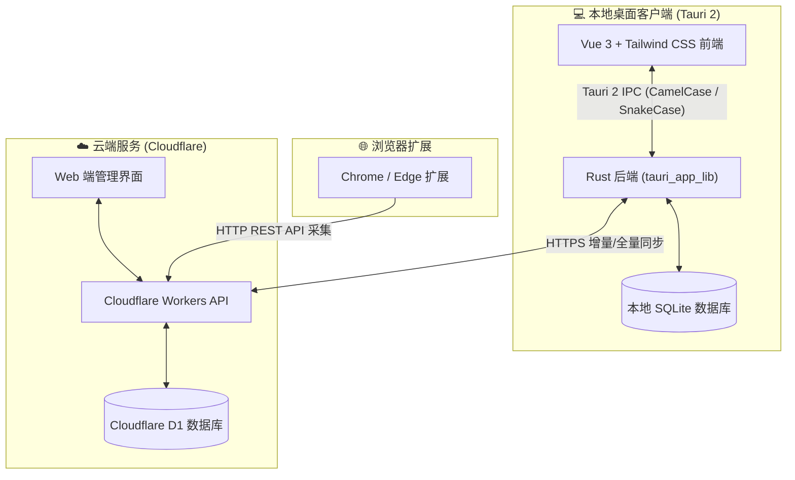

# Bookmark Manager (书签管理器) v1.0.0

一款专为海量书签（万级数据量）设计的现代跨端全栈书签管理系统。

结合 **Tauri 2 (Rust) 桌面客户端** + **Vue 3 / Tailwind CSS** 前端 + **Cloudflare Workers / D1** Serverless 云端服务 + **Chrome / Edge 浏览器扩展**，提供极致轻快、安全可控、无缝跨端同步的个人知识库底座。

---

## 🌟 核心特性

- 🚀 **万级书签极速流畅**：基于本地嵌入式 SQLite 与 Rust 后端，单机轻松承载 10,000+ 条书签，毫秒级即时检索与模糊过滤。
- 📁 **多级无限层级分类与拖拽交互**：
  - 支持任意深度的树状分类体系（展开/折叠、行内直接重命名、新建子分类）。
  - **流畅拖放交互**：支持直接抓取书签卡片拖拽入左侧分类快速归类，支持在左侧侧边栏通过手柄自由拖动调整分类先后顺序与父子嵌套层级。
- 🔍 **智能 URL 规范化与入库前实时预去重**：
  - 自动剥离末尾冗余斜杠、默认端口号（`:80`/`:443`）、跟踪参数（`utm_*` 等），统一域名大小写。
  - 导入 Netscape HTML 书签文件时，支持**增量去重合并**与**全新清空覆盖**双重模式，精准提示插入条数与跳过重复数。
- ☁️ **Serverless 双向增量同步**：
  - 无缝打通 Cloudflare Workers 与 D1 分布式数据库。
  - 支持双向增量同步（基于 `updated_at` 时间戳与增量分页机制）、一键强制覆盖云端、一键强制拉取覆盖本地。
  - 针对 Cloudflare 免费版 CPU 限制，采用优化的单批次 D1 Batch 事务合并，彻底消除 1101 CPU 超时。
- 🧪 **网站健康体检与智能抓取**：
  - 批量死链与可用性检测（高并发检测网站 HTTP 状态码、记录失效原因与拦截标记）。
  - 内置代理配置支持（HTTP/SOCKS5），无惧网络阻断。
  - 智能抓取网站 Favicon 图标与页面元信息，集成 AI 自动分类/打标建议。
- 🔌 **浏览器扩展无缝整合**：
  - 提供开箱即用的 Chrome / Edge 扩展插件，支持在浏览任意网页时一键采集入库，自动同步至云端与本地。

---

## 🏗️ 架构概览



---

## 📦 下载与安装

进入项目的 [GitHub Releases](https://github.com/taylormao/bookmark-manager/releases) 页面，下载最新的安装包：

- **Windows 安装程序**：`bookmark-app_1.0.0_x64-setup.exe` (或独立绿色免安装包 `bookmark-app.exe`)
- 下载完成后双击即可启动运行。

---

## 🛠️ 本地开发指南

### 1. 环境准备
- [Bun](https://bun.sh/) 或 Node.js (v18+)
- [Rust](https://www.rust-lang.org/) (建议最新稳定版)
- C++ 构建工具 (Windows 下需安装 Visual Studio C++ 生成工具)

### 2. 启动桌面端开发模式
```bash
# 安装依赖
bun install

# 启动 Tauri 桌面开发窗口 (热重载)
bun run tauri dev
```

### 3. 部署 Cloudflare Workers 服务端
```bash
cd worker
bun install

# 本地初始化或部署到云端
bunx wrangler d1 execute bookmark-db --remote --file=./schema.sql
bunx wrangler deploy
```

---

## 📚 详细文档

- 深入技术难点复盘、架构设计权衡与进阶学习指南：请参阅 [工程开发经验与技术难点手册 (ENGINEERING_MANUAL.md)](docs/ENGINEERING_MANUAL.md)。
- 需求分析与完整规范：请参阅 [bookmark-manager-requirements.md](bookmark-manager-requirements.md)。

---

## 📄 开源协议

本项目采用 [MIT 许可证](LICENSE)。
