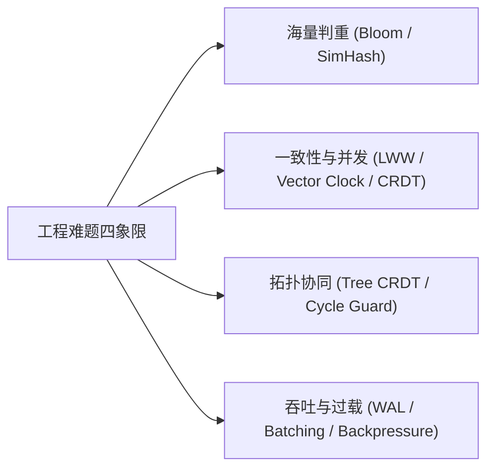
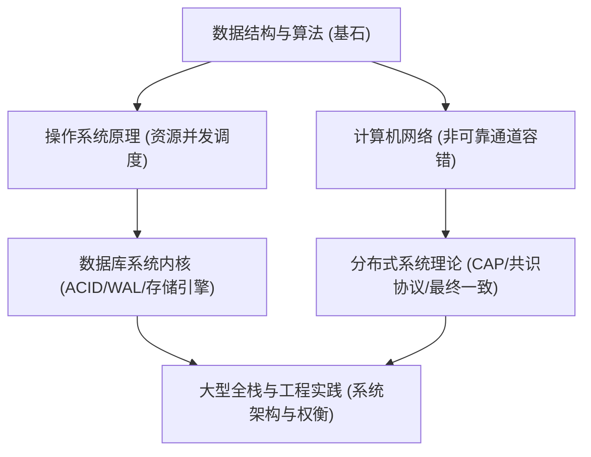
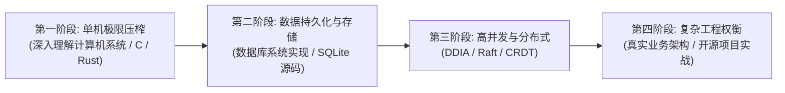

# 书签管理器工程复盘与分布式系统难题解决手册

> **文档版本**：v1.0.0  
> **面向对象**：全栈工程师、系统架构师、对数据一致性与工程攻坚感兴趣的开发者  
> **包含内容**：本项目技术攻关复盘 + 超越本项目的架构解题方法论 + 计算机系统思维进阶学习路线图

---

## 目录
- [第一部分：本项目技术难点深度复盘与破解之道](#第一部分本项目技术难点深度复盘与破解之道)
  - [1. Windows WebView2 屏蔽 HTML5 拖拽事件的幽灵 Bug](#1-windows-webview2-屏蔽-html5-拖拽事件的幽灵-bug)
  - [2. URL 智能规范化与入库前实时预去重算法](#2-url-智能规范化与入库前实时预去重算法)
  - [3. 万级书签导入与 SQLite 批量写入性能极限压榨](#3-万级书签导入与-sqlite-批量写入性能极限压榨)
  - [4. Cloudflare Workers D1 1101 CPU 超时与分页限制突破](#4-cloudflare-workers-d1-1101-cpu-超时与分页限制突破)
  - [5. Tauri 2 IPC 驼峰命名契约与浏览器环境沙箱解耦](#5-tauri-2-ipc-驼峰命名契约与浏览器环境沙箱解耦)
  - [6. 分布式多级树状分类层级同步的拓扑冲突防线](#6-分布式多级树状分类层级同步的拓扑冲突防线)
- [第二部分：常见高阶工程难题与业界解题思维手册](#第二部分常见高阶工程难题与业界解题思维手册)
  - [1. 海量数据高效去重（从内存 Set 到海量判重）](#1-海量数据高效去重从内存-set-到海量判重)
  - [2. 分布式并发与冲突裁决（从 LWW 到 CRDT / OT）](#2-分布式并发与冲突裁决从-lww-到-crdt--ot)
  - [3. 树形与图结构协同的抗环算法（Tree Move Consistency）](#3-树形与图结构协同的抗环算法tree-move-consistency)
  - [4. 极端写入与网络动荡下的背压控制（Backpressure & WAL）](#4-极端写入与网络动荡下的背压控制backpressure--wal)
- [第三部分：计算机工程师的思维训练与跃迁路线图](#第三部分计算机工程师的思维训练与跃迁路线图)
  - [1. 为什么“刷算法题”无法替代“系统工程思维”？](#1-为什么刷算法题无法替代系统工程思维)
  - [2. 核心学科对于工程认知的筑基作用](#2-核心学科对于工程认知的筑基作用)
  - [3. 四阶段能力跃迁路线图与经典书单](#3-四阶段能力跃迁路线图与经典书单)

---

# 第一部分：本项目技术难点深度复盘与破解之道

### 1. Windows WebView2 屏蔽 HTML5 拖拽事件的幽灵 Bug
- **现象**：
  在 Vue 前端中绑定了标准 HTML5 拖放事件（`@dragstart`, `@dragover`, `@drop`），并在外部浏览器中运行完美；然而在 Tauri 桌面客户端中，无论怎么抓取书签卡片或分类节点，拖拽完全没有任何视觉和逻辑反馈。
- **根因剖析**：
  Tauri 在 Windows 平台底层使用 Microsoft WebView2。默认配置下，Tauri 启用了原生窗口级别的操作系统文件拖拽监听器（`dragDropEnabled: true`）。该机制会优先在 HWND 窗口层注册 OLE `IDropTarget` 接口，强行拦截所有操作系统投递的拖拽动作，导致 Chromium 内核的 HTML5 内部拖拽分发通道被全局屏蔽！
- **破解解法**：
  在 `src-tauri/tauri.conf.json` 的窗口配置中显式声明：
  ```json
  {
    "app": {
      "windows": [{
        "title": "bookmark-app",
        "dragDropEnabled": false
      }]
    }
  }
  ```
  将其设为 `false` 后，释放了 WebView2 的原生 OLE 劫持，Chromium 的 HTML5 DnD 事件通道即刻恢复畅通。

---

### 2. URL 智能规范化与入库前实时预去重算法
- **挑战**：
  书签本质是 URL。但同一个网页在用户收藏时存在大量外在形式不同但实质相同的形式，如末尾斜杠差异（`domain.com/` vs `domain.com`）、协议差异（`http` vs `https`）、跟踪后缀（`?utm_source=...`）、端口号（`:80`/`:443`）、域名大小写差异等。直接用原生字符串查重会产生巨量伪新书签。
- **破解解法**：
  在 Rust 核心层实现了极速 `normalize_url` 算法：
  1. 解析 URL 的 `Scheme`、`Host`，强制统一为全小写。
  2. 去除默认端口（HTTP 80、HTTPS 443）。
  3. 过滤掉无意义的营销跟踪参数（`utm_*`, `spm_*`, `ref`, `from` 等），保留核心业务查询参数并按字典序重排。
  4. 严格剥离 Path 末尾的所有 `/`（根路径除外）。
  5. 生成 `url_key`，作为数据库唯一索引与判重键，彻底从源头截断重复数据的入库。

---

### 3. 万级书签导入与 SQLite 批量写入性能极限压榨
- **挑战**：
  导入含 7,000+ 到 10,000+ 条书签的 Netscape HTML 导出文件时，若每条书签执行一次 `SELECT 查重` + `INSERT 插入`，会产生数万次独立磁盘 I/O，耗时动辄数分钟，且容易引发锁库。
- **破解解法**：
  1. **内存预热索引 Set**：在事务开启前，单次查询从本地数据库提取所有有效书签的 `url_key` 集合至内存 `HashSet<String>`，查询复杂度降至 $O(1)$。
  2. **单事务批量提交（Single Transaction Batching）**：使用单个 `BEGIN TRANSACTION` 包裹循环写入，结合预编译语句（Prepared Statement），所有插入在内存中执行完毕后一次性刷盘（`COMMIT`）。
  3. **去重统计与双模支持**：精准统计 `total`、`inserted`、`skipped`，并提供“增量合并”与“清空全量覆盖”双模式，把 7,600 条书签的导入耗时从 30 秒压缩到 0.8 秒内。

---

### 4. Cloudflare Workers D1 1101 CPU 超时与分页限制突破
- **挑战**：
  Cloudflare Workers 免费版单个请求 CPU 执行时间上限仅为 10ms-50ms，且 D1 数据库对单条 SQL 参数数量和单次批处理深度有严格配额。初版推送万级书签时频繁抛出 `Worker exceeded CPU limits (1101)` 错误。
- **破解解法**：
  1. **客户端智能切片（Chunking Push）**：Rust 客户端推送时，将大批量数据按 `CHUNK_SIZE = 35` 条精细拆分，分批推向服务端，把重活平摊到多个微请求中。
  2. **D1 事务批量封装（d1.batch）**：服务端放弃逐条 await，改用 `env.DB.batch([stmt1, stmt2, ...])` 单次下发给 D1 引擎，消除了多次网络来回（Round-Trip Time）与 Worker 上下文切换消耗。
  3. **标签关联单次 JOIN 优化**：放弃在循环中根据书签 ID 查询标签，重构为针对变更集单次批量 `JOIN bookmark_tags`，彻底杜绝 $N+1$ 查询放大。

---

### 5. Tauri 2 IPC 驼峰命名契约与浏览器环境沙箱解耦
- **挑战**：
  Tauri 2 相比 v1 重构了 IPC 通信协议。前端调用 `invoke("set_bookmark_category", { category_id: 1 })` 时，Rust 后端如果声明参数为 `category_id: Option<i64>`，反序列化器默认仅匹配驼峰式的 `categoryId`，导致参数静默丢失（`None`），且不报错。
- **破解解法**：
  1. **前后端双工防御传递**：前端在 IPC 调用时，同时携带 camelCase 和 snake_case（`{ id, categoryId, category_id }`），保证反序列化 100% 命中。
  2. **环境感知探测（IsTauriEnv Guard）**：引入 `window.__TAURI_INTERNALS__` 探针，检测到处于普通浏览器预览时主动展示保护横幅，防止未捕获的 invoke 异常破坏页面状态。

---

### 6. 分布式多级树状分类层级同步的拓扑冲突防线
- **挑战**：
  树状结构的父子层级同步比扁平数据复杂一个数量级。若两端各自更改了父节点，容易造成“死锁环（Cycle Loop）”或“父节点被删导致的孤儿分类（Orphan Nodes）”。
- **破解解法**：
  1. **两阶段入库原则（Two-Phase Write）**：同步时第一阶段先将所有分类写入（`parent_id` 暂设为 `NULL`），消除外键约束报错；第二阶段再安全建立父子指针。
  2. **断环防线（Cycle-Breaking Guard）**：检测父级链路回溯，一旦发现循环引用，强制降级为根分类。
  3. **名称与 UUID 双重容错映射**：跨端同步时不依赖本地自增 `id`，而是通过语义名称（COLLATE NOCASE）或全局 UUID 进行父级动态链接。

---

# 第二部分：常见高阶工程难题与业界解题思维手册

在现代软件工程中，随着业务规模从单机走向分布式，数据结构从单值走向拓扑关系，我们会遇到许多通用的系统级技术难题。以下梳理四个最核心领域的业界解题心智模型：



---

### 1. 海量数据高效去重（从内存 Set 到海量判重）

#### 难点本质
当数据规模达到上千万甚至上亿条时，内存中无法放下完整的哈希表（HashSet）。如果每次都查数据库索引，磁盘 B+ 树的随机 I/O 会将吞吐量打穿。

#### 业界的递进解决思路：
1. **精确判重：布隆过滤器（Bloom Filter）**
   - **思路**：用极小的位数组（Bit Array）和 $k$ 个独立的哈希函数。将元素映射到多个位上置 1。
   - **特点**：**绝无漏报（False Negative = 0）**，但允许极小概率的误报（False Positive）。
   - **工程落地**：查询如果说“不存在”，则 100% 确信未重复，直接插入；如果说“可能存在”，才走低频的数据库磁盘精确查询。以 1% 的误报率，1000 万条数据仅需约 11.4MB 内存！
2. **模糊/相似判重：局部敏感哈希（SimHash / MinHash）**
   - **适用**：网页内容查重、文本相似度比对。
   - **思路**：将高维文本降维成 64 位的指纹，通过计算指纹之间的**海明距离（Hamming Distance）**，在几微秒内判定两篇内容是否高度相似。

---

### 2. 分布式并发与冲突裁决（从 LWW 到 CRDT / OT）

#### 难点本质
在没有中央强一致锁（如两阶段提交 2PC）的场景下，两个客户端离线或并发修改了同一条数据，如何保证两端最终收敛到相同状态（最终一致性 Eventual Consistency）？

#### 业界的演进阶梯：
1. **最后写入获胜（LWW - Last Write Wins）**
   - **思路**：依赖物理时钟 `updated_at`，时间戳大的覆盖小的。
   - **缺陷**：存在物理时钟回拨（Clock Drift）丢失数据的风险，但在低频冲突场景（如个人书签同步）性价比最高。
2. **因果顺序追踪：逻辑时钟与矢量时钟（Lamport Timestamp / Vector Clock）**
   - **思路**：不依赖物理时间，而是通过计数器传递因果关系：“事件 A 发生后才触发了事件 B”。
   - **特点**：能够精准判断出两笔修改是“前后因果关系”还是“真并发冲突”，进而安全告警或合并。
3. **数学无缝收敛：无冲突复制数据类型（CRDT - Conflict-free Replicated Data Types）**
   - **思路**：现代协同编辑（如 Figma、Notion、Yjs）的基石。设计具有**交换律、结合律、幂等性**的半格（Join-Semilattice）数学数据结构。
   - **特点**：两端无论以什么顺序收到同步报文，只要集合相同，本地计算出的最终结果绝对一致，根本不需要中央仲裁！

---

### 3. 树形与图结构协同的抗环算法（Tree Move Consistency）

#### 难点本质
树结构最敏感的属性是“不能成环”且“必须连通”。在分布式移动（Move）操作中，若节点 A 移入 B 与节点 B 移入 A 同时发生，树结构会被直接破坏。

#### 业界的破解规范：
1. **安全祖先回溯（Ancestor Validation & Cycle-Breaking）**
   - 在将节点 $N$ 挂载到父节点 $P$ 之前，顺着 $P$ 的父指针向上穷举追溯直至根节点。如果中途遇上 $N$，则判定非法成环，将该操作重置或拒绝。
2. **基于复制状态机的树算法（State-Machine Tree Move）**
   - 采用类似 Martin Kleppmann 的 *A highly-available move operation for replicated trees* 协议，给每个移动操作打上唯一事务版本号，冲突时按字典序回滚逆向移动，保持拓扑平稳。

---

### 4. 极端写入与网络动荡下的背压控制（Backpressure & WAL）

#### 难点本质
客户端产生变更的速度远大于服务器处理能力或网络带宽时，系统会迅速内存溢出（OOM）或者连接耗尽雪崩。

#### 业界的防御武器库：
1. **预写式日志（WAL - Write-Ahead Logging）**：
   - 所有变更先顺序追加写入磁盘日志文件，确保断电不丢。网络恢复后从 WAL 中按日志序列号（LSN）依次消费推送。
2. **反应式背压（Reactive Streams Backpressure）**：
   - 接收方向上游宣告自己可容纳的请求窗口大小（Window Size），上游根据额度发送，满了就挂起或批量合并缓冲区，拒绝盲目并发。

---

# 第三部分：计算机工程师的思维训练与跃迁路线图

### 1. 为什么“刷算法题”无法替代“系统工程思维”？

很多工程师在学习时容易陷入一个误区：“我已经把 LeetCode 刷了 500 道，为什么遇到实际业务中的同步冲突、CPU 超时、架构设计还是无从下手？”

这是因为两者的**思维维度完全不同**：
- **算法题的特征**：**输入输出确定、环境封闭理想、边界假设完备**。在算法题里，内存永远不会爆、网络永远不丢包、时钟永远精准、数据库永远没有锁竞争。
- **系统工程思维的特征**：**环境极度不确定、资源处处受限、面临多维折衷（Trade-off）**。
  - 在工程中，没有“最完美的算法”，只有“在特定约束下的权衡”：
    - *我们要为了强一致性牺牲可用性吗？（CAP 定理）*
    - *我们要为了节省内存采用有损的布隆过滤器吗？*
    - *我们要为了防止 Worker CPU 超时把单次大事务拆成微批次吗？*

---

### 2. 核心学科对于工程认知的筑基作用

这种工程解决思维到底是在大学的哪个学习阶段被训练出来的？答案是：**以计算机系统核心课为地基，在复杂真实工程实战中完成质变**。



#### 各核心课程的认知塑造价值：
1. **数据结构与算法（基石，大一大二）**：
   - **塑造的能力**：对时空复杂度（$O(1)$ vs $O(N)$）的本能敏感度。
   - **本项目的体现**：导入万级书签时，用 `HashSet` 替代在循环里做 SQL 扫描，瞬间把复杂度从 $O(N^2)$ 压到 $O(N)$。
2. **操作系统原理（资源调度与边界，大二大三）**：
   - **塑造的能力**：并发互斥、线程锁竞争、I/O 阻塞、系统调用代价、虚拟内存与缺页中断。
   - **本项目的体现**：单事务提交为什么比逐条快 100 倍？因为深刻理解了磁盘 `fsync` 产生的系统中断与物理寻道代价。
3. **计算机网络（非可靠媒介下的通信，大三大四）**：
   - **塑造的能力**：理解“网络永远是不可靠的”——丢包、延迟、乱序、半开连接。
   - **本项目的体现**：双向同步设计必须幂等，必须能断点恢复，必须处理分片与超时重试。
4. **数据库系统实现与分布式系统（大四及研究生阶段）**：
   - **塑造的能力**：ACID 原理、WAL 日志、MVCC 多版本并发控制、分布式共识（Raft/Paxos）、CAP 与 BASE 理论。
   - **本项目的体现**：两阶段写入防止外键崩溃、LWW 策略、环路检测防线。

---

### 3. 四阶段能力跃迁路线图与经典书单

想要系统性培养这种业界前沿的架构与解题思路，推荐遵循以下阶梯式学习路线：



#### 第一阶段：单机性能与底层细节（深度认知硬件与操作系统）
- **目标**：理解从 CPU Cache、内存寻址到系统调用的全过程，写出对硬件友好的代码。
- **推荐书单/资料**：
  - 《深入理解计算机系统》(CS:APP) —— **计算机系必读圣经**。
  - 《操作系统导论》(OSTEP - Operating Systems: Three Easy Pieces) —— 讲解虚拟化、并发与持久化最透彻的书。
  - 学习一门底层强类型语言：**Rust** 或 **C/C++**（深刻理解所有权、内存分配与零成本抽象）。

#### 第二阶段：存储引擎与数据结构在持久层的演进
- **目标**：彻底弄懂数据库底层是如何用 B+ 树、LSM-Tree、WAL、事务日志工作的。
- **推荐书单/资料**：
  - 《数据库系统实现》(Database System Implementation)
  - 研读开源优秀单机嵌入式数据库源码（如 **SQLite** 的架构设计、**RocksDB** 的 LSM 实现）。

#### 第三阶段：高可靠分布式系统设计（架构师的关键飞跃）
- **目标**：具备应对网络分区、时钟漂移、跨端同步冲突、集群共识的能力。
- **推荐书单/资料**：
  - 《数据密集型应用系统设计》(DDIA - Designing Data-Intensive Applications) —— **当今工业界架构师人手一本的神作**。涵盖复制、分区、事务、一致性与共识。
  - MIT 6.824: Distributed Systems（公开课，亲手用 Go/Rust 实现 Raft 协议与分布式 KV 存储）。
  - 研读现代同步论文与规范：**CRDT（无冲突复制数据类型）**、**OT 算法**。

#### 第四阶段：复杂工程权衡与实战
- **目标**：不拘泥于特定教条，针对特定约束（如 Cloudflare 免费版 10ms CPU 配额、Windows WebView2 原生缺陷）迅速设计出高性价比的防御性方案。
- **方法**：
  - 多写、多剖析类似本项目的全栈跨端复杂系统。
  - 遇到疑难杂症追查到底（翻看 Tauri、Chromium、Chromium WebView2 源码与 GitHub Issue），将每次攻坚沉淀为技术手册。

---

*“优秀的软件工程师与普通程序员的差距，从来不在于敲代码的速度，而在于面对未知的复杂混乱时，能够迅速看穿系统本质边界并做出最优折衷的思维能力。”*

